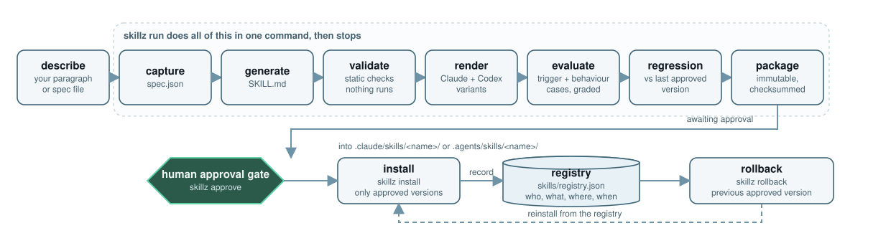
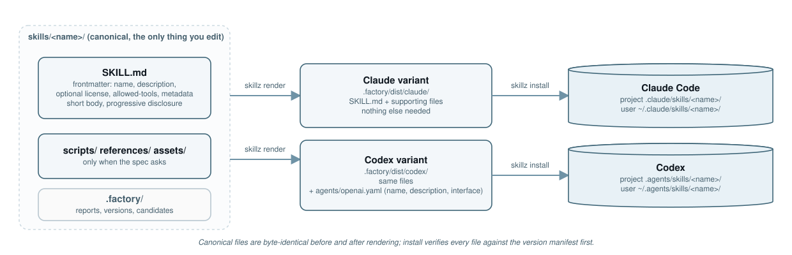
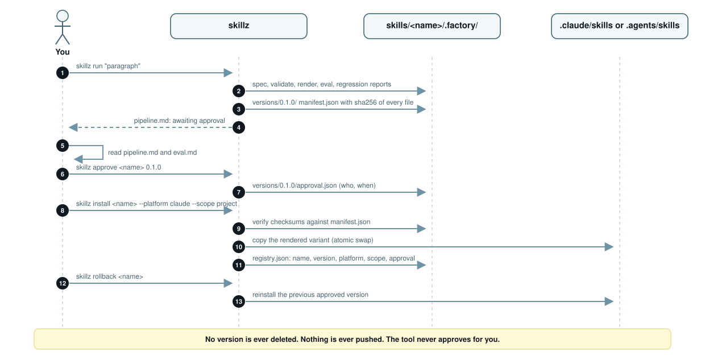
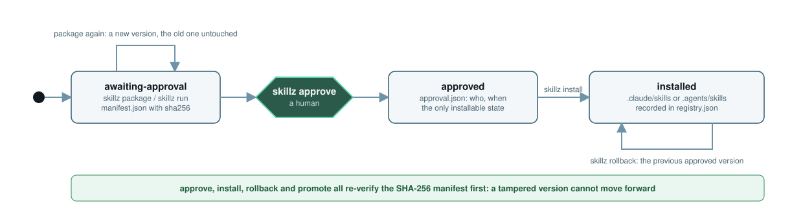
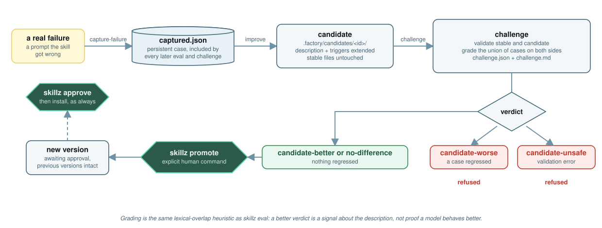
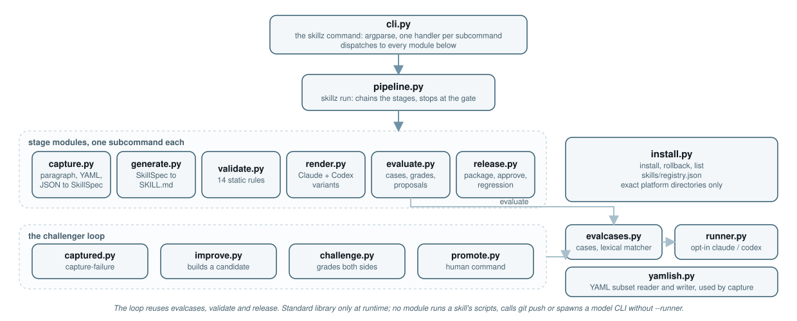

<p align="center">
  
</p>

<p align="center">
  <a href="https://github.com/Jimmycarroll2021/skill-factory/actions/workflows/ci.yml"></a>
  <a href="LICENSE"></a>
  
  
  
</p>

**skill-factory is the regression layer for Agent Skills: skills with receipts.** An Agent Skill is a `SKILL.md` that a coding agent loads when a prompt matches its description. Skills get installed with no evidence that they do not make the agent worse: nobody checks which prompts the new version handles that the old one did not, and which it now gets wrong. `skillz` packages every version of a skill with a receipt: a record of what was checked, how (lexical grading, or a model run judged by another model), and a per-case comparison with the last approved version split into gains and regressions. A regressed version cannot be approved without a written reason, and nothing is installed until a human approves it. The receipt format is [docs/RECEIPT.md](docs/RECEIPT.md).

It works on any skill, not only generated ones: a hand-written `skills/<name>/SKILL.md` with an `evals/evals.json` gets evaluated, judged, packaged and receipted the same way. Everything runs offline and deterministically with the Python standard library; model-backed runs are opt-in and never needed to finish.

## Get a receipt for an existing skill

Requirements: Python 3.12 and [uv](https://docs.astral.sh/uv/). Put the skill under `skills/<name>/` in your project with an `evals/evals.json` (entries `{id, prompt, should_trigger, assertions}`, see [the standard](docs/SKILL-STANDARD.md)). Each entry is a trigger case; an entry with `should_trigger: true` and assertions is also a behaviour case whose rubric is the assertions.

```bash
# 1. grade the trigger and behaviour cases offline (no model; a lexical heuristic)
uv run skillz eval <name>

# 2. package an immutable version; with --runner, run and judge the behaviour cases too
uv run skillz package <name> --runner claude

# 3. read the receipt: evidence level, gains and regressions against the last approved version
uv run skillz receipt <name>

# 4. a human approves; a regressed receipt needs a reason
uv run skillz approve <name> 0.1.0
uv run skillz approve <name> 0.1.1 --accept-regressions "the dropped case was a bad prompt"

# 5. install for Claude Code or Codex; only approved versions install
uv run skillz install <name> --platform claude --scope project
```

The receipt is `skills/<name>/.factory/versions/<semver>/receipt.json` with a Markdown rendering next to it, both covered by the version's checksum manifest. This `receipt.md` is real output, reproduced by `tests/test_docs.py`: the hand-written skill in `tests/fixtures/foreign-skill/` was packaged at 0.1.0 and approved, its description was replaced with one about planning dinners, and it was packaged again with `--allow-regression`:

```markdown
# Receipt: foreign-skill 0.1.1 — evidence: unverified

- Baseline: 0.1.0
- Trigger: 10 checked, 8 passed, 2 failed (lexical-overlap, threshold 0.3)
- Behaviour: no judge ran
- Status: regressed

## Regressions

| id | kind | prompt | before → after |
| --- | --- | --- | --- |
| `evl-announcement-from-changelog` | positive | Turn the changelog entries for this release into a GitHub release announcement | pass → fail |
| `evl-drafts-release-notes` | positive | Draft release notes for version 2.3 from our CHANGELOG.md | pass → fail |
| `pos-001` | positive | Convert a Markdown changelog into GitHub release notes grouped by section. | pass → fail |

## Gains

None.

Judge: none; runner: none.
```

The two lines count different things, on purpose. The trigger line grades this version's own cases: the two `evals.json` prompts about release notes now fail. The regression table re-grades the cases the baseline recorded, and only those, so it also catches `pos-001`, the prompt generated from the old description, which the new version no longer has. A case that exists only in the new version (a new `evals.json` entry, a newly captured failure) is graded on the trigger line but cannot be a gain or a regression, because the baseline never saw it.

Three evidence levels, earned not declared: `unverified` means only the lexical grading ran and no model saw the skill; `self-judged` means one model ran the cases and scored its own transcripts; `verified` means a different model judged (the default when both `claude` and `codex` CLIs are installed). `skillz list` shows the level of every installed version.

## The pipeline

<p align="center">
  
</p>

The same stages as a plain list:

1. describe: you write a paragraph, or a small YAML or JSON spec (or skip this and the next two: a hand-written skill starts at validate)
2. capture: `skillz` turns it into a structured spec (name, description, triggers, non-triggers, behaviours)
3. generate: the canonical `skills/<name>/` directory is written
4. validate: static checks on structure, size and forbidden patterns; nothing is executed
5. render: the Claude and Codex install variants are built from the canonical source
6. evaluate: trigger and behaviour cases from the spec, `evals/evals.json` and captured failures are graded; with `--runner`, a judge model scores each behaviour case with and without the skill
7. regression: the candidate is compared case by case with the last approved version, into gains and regressions
8. package: an immutable, checksummed version is created under `.factory/versions/` with its receipt
9. human approval gate: you run `skillz approve`; nothing is installable before this
10. install: the approved version is copied into the platform directory, and only there
11. registry: installs and their evidence level are recorded in `skills/registry.json`; `skillz rollback` reinstalls the previous approved version

`skillz run <source>` performs stages 2 to 8 for a paragraph or spec and stops at the gate. It never approves, never installs and never promotes. Each stage can also be run on its own (`skillz validate`, `skillz render`, `skillz eval`, `skillz judge`, `skillz package`). The pipeline's regression line reads like `pass (2 gains, 0 regressions vs 0.1.0; 7 cases compared)`.

## One source, two platforms

Claude Code and Codex both read the open Agent Skills format, so there is one canonical skill and two thin renderings of it. The canonical files are never edited per platform; `skillz render` proves they are byte-identical before and after rendering.

<p align="center">
  
</p>

| Layer | Shared (canonical) | Claude variant | Codex variant |
|---|---|---|---|
| Instructions | `SKILL.md` with spec-compliant frontmatter | same file | same file |
| Supporting files | `scripts/`, `references/`, `assets/` | copied | copied |
| Platform metadata | none | none needed | `agents/openai.yaml` (name, description, interface) |
| Install path | `skills/<name>/` in your project | `.claude/skills/<name>/` or `~/.claude/skills/<name>/` | `.agents/skills/<name>/` or `~/.agents/skills/<name>/` |

## A release, step by step

<p align="center">
  
</p>

## Version lifecycle

<p align="center">
  
</p>

- A version directory is never modified after creation. `skillz approve`, `install` and `rollback` all re-verify the SHA-256 manifest first, so a tampered version or receipt cannot be approved or installed.
- `skillz package` compares the new candidate with the previous approved version's cases. A regression (a case that passed before and fails now, or a behaviour case whose judge score dropped) stops the package unless you pass `--allow-regression`; the receipt then says `regressed`.
- `skillz approve` refuses a `regressed` receipt unless you pass `--accept-regressions "<reason>"`; the reason and the case ids are recorded in `approval.json`.
- `skillz install` refuses anything that is not approved, with a non-zero exit and no files written.

## Self-improvement (the challenger loop)

When a skill gets a prompt wrong in real use, you do not edit the stable skill. You record the failure, edit a candidate copy, and let the challenge decide.

<p align="center">
  
</p>

```bash
# 1. record the failure; every later eval, package and challenge includes it
uv run skillz capture-failure <name> --prompt "Help me write a SKILL.md file" --should-trigger

# 2. copy the stable skill to skills/<name>/.factory/candidates/<id>/skill/ and edit the copy
uv run skillz candidate <name>

# 3. compare candidate with stable and read the verdict in challenge.md
uv run skillz challenge <name> c001

# 4. a human decides: promote, then approve the new version as usual
uv run skillz promote <name> c001
uv run skillz approve <name> <new-version>
```

- `capture-failure` appends to `.factory/cases/captured.json` with `--should-trigger`, `--should-not-trigger` or `--expect MARKER ...` (a behaviour case). Records are never rewritten.
- `candidate` copies the stable skill into a candidate directory for you to edit by hand. The stable files are untouched. The tool does not rewrite your skill for you.
- `challenge` validates the stable skill and the candidate, grades the union of both sides' cases plus the captured ones (and, with `--runner`, judges the behaviour cases on both sides), and gives one verdict, by precedence: `candidate-unsafe` (the candidate has a validation error), `candidate-worse` (a case that passed on stable fails on the candidate), `candidate-better` (a case improved, none regressed) or `no-difference`.
- `promote` refuses unless the challenge is current and the verdict is `candidate-better` or `no-difference`. It replaces the canonical files, packages a new `awaiting-approval` version with its receipt and leaves earlier versions byte-identical. A refused or failed promote changes no canonical file, and the same candidate cannot be promoted twice.

Promotion is an explicit human command. `skillz run` and the pipeline never promote, approve or install. Without `--runner`, grading is the same lexical-overlap heuristic as `skillz eval`: a better verdict is a signal about the description, not proof that a model will behave better.

The meta-skill in `skills/skill-factory/` was fixed this way. It missed the prompt "Help me write a SKILL.md file so my agent learns this workflow" (overlap score 0.14, below the 0.3 threshold); the prompt was captured, a candidate was challenged, the verdict was `candidate-better` with no regressions, and the candidate was promoted. The committed report is [docs/evidence/skill-factory-challenge.md](docs/evidence/skill-factory-challenge.md).

## Model-backed quality tier

Quality is checked in six tiers, from cheap and certain to expensive and human. Each tier adds evidence; none replaces the one before it. The receipt's `evidence` field says how far up the ladder a version got.

1. static validation: structure, size and forbidden patterns (`skillz validate`); nothing is executed
2. offline trigger heuristics: lexical-overlap grading of positive and negative prompts (`skillz eval`); deterministic, no model; a receipt built from this alone is `unverified`
3. Claude/Codex behavioural execution: each behaviour case is run through the `claude` or `codex` CLI with and without the skill (`--runner`)
4. independent model judge: a model scores the two transcripts against the case's rubric (`skillz judge`); same model as the runner gives a `self-judged` receipt
5. cross-model evaluation: the judge is a different model from the one that ran the skill whenever both CLIs are on PATH; this gives a `verified` receipt
6. human approval: `skillz approve` and `skillz promote` stay explicit human commands, whatever the scores say

**The lexical tier is the default, and nothing calls a model without `--runner`.** `skillz run`, `eval`, `package` and `challenge` with no `--runner` are offline and deterministic, and the model-backed stages record `skipped: no runner`. Offline grading is a heuristic (lexical overlap between test prompts and the description), not proof that a model triggers the skill, so an `unverified` receipt is lexical only and says nothing about behaviour. Tiers 3 to 5 cost model calls, so they are opt-in.

```bash
# score every behaviour case with and without the skill (about three model calls per case)
uv run skillz judge <name> --runner claude

# choose the judge yourself, for example Codex judging Claude's transcripts
uv run skillz judge <name> --runner claude --judge codex
```

`skillz judge` runs each case prompt through the runner twice, once with the skill text in the prompt and once without, and keeps both transcripts (each capped at 4000 characters in the report). A separate judge call sees both transcripts under neutral labels, with the with-skill side placed on a deterministic, per-case label so position does not favour either side. It scores each transcript 0 to 5 on `instruction_following` and `task_quality` against the case's rubric and names a winner with a reason. The judge's JSON reply is parsed strictly: integer scores from 0 to 5 on both dimensions for both sides, a winner of `a`, `b` or `tie`, and a non-empty reason. A malformed reply is recorded as a per-case error, counts as neither better nor worse, and the command still finishes. Without `--runner`, or when the runner or judge executable is not on PATH, it records `skipped: no runner` (or `skipped: no judge`), writes the report anyway and exits 0. Reports go to `.factory/judge.json` and `judge.md`.

With `--runner`, the judge scores feed the decisions: `skillz challenge` folds them into its verdict, `skillz package` stores them in the version's `reports/` and the next package compares scores case by case, and `skillz run` adds a judge stage between evaluate and regression so the model is not called twice. A judge is a model and can be wrong or biased; treat its scores as one more signal for the human at the gate. The committed run of `skillz judge` against the real Claude CLI is in `docs/evidence/judge-claude.md` (raw `docs/evidence/judge-claude.json`).

## Commands

Pass `--out <dir>` to any command to work on a different project root; the default is the current directory.

| Command | What it does | Exit codes |
| --- | --- | --- |
| `skillz new <source> [--name NAME] [--force]` | Capture a skill from a paragraph or a `.txt`/`.yaml`/`.yml`/`.json` spec and generate `skills/<name>/`. | 0, 2 |
| `skillz validate <name>` | Check frontmatter, naming, paths, sizes, secrets, network calls and destructive shell. Writes `.factory/validate.json` and `validate.md`. | 0 clean, 1 errors, 2 missing |
| `skillz render <name>` | Build the Claude and Codex variants under `.factory/dist/` without touching canonical files. | 0, 2 |
| `skillz eval <name> [--runner {claude,codex}] [--strict]` | Collect cases from the spec, `evals/evals.json` and captured failures, grade them offline, propose improvements; with `--runner`, run each behaviour case with and without the skill. | 0 (advisory), 1 with `--strict` on a failing trigger case, 2 |
| `skillz judge <name> [--runner {claude,codex}] [--judge {claude,codex}]` | Run each behaviour case with and without the skill, have a judge model score both transcripts 0 to 5 against the rubric, and write `.factory/judge.json` and `judge.md`. Cross-model by default when both CLIs are on PATH; `skipped: no runner` without `--runner`. | 0, 2 |
| `skillz package <name> [--minor \| --major] [--set-version X.Y.Z] [--allow-regression] [--runner {claude,codex}] [--judge {claude,codex}]` | Validate, render and evaluate, compare with the last approved version into gains and regressions, and write an immutable version with its receipt under `.factory/versions/<semver>/`. | 0, 1 validation or regression, 2 clash or missing |
| `skillz approve <name> <version> [--accept-regressions REASON]` | Verify checksums and record approval (UTC time and local user). Refuses a `regressed` receipt without a reason. The only way a version becomes installable. | 0, 1 integrity or regressed, 2 missing |
| `skillz receipt <name> [version] [--json]` | Print a version's receipt (default: the highest version): evidence level, trigger and behaviour counts, gains and regressions. | 0, 1 no receipt, 2 missing |
| `skillz install <name> --platform {claude,codex} --scope {project,user} [--version X.Y.Z]` | Install an approved version (default: highest approved) and record it, with its evidence level, in `skills/registry.json`. | 0, 1 not approved or integrity, 2 |
| `skillz rollback <name> [--platform {claude,codex}] [--scope {project,user}]` | Reinstall the highest approved version below the installed one. Versions are never deleted. | 0, 1 nothing to roll back to, 2 |
| `skillz list [--json]` | Show the registry and each skill's versions with their status and evidence level. | 0 |
| `skillz run <source> [--name NAME] [--runner {claude,codex}] [--judge {claude,codex}] [--force]` | The pipeline from a paragraph or spec: capture, generate, validate, render, evaluate, (judge with `--runner`), regression, package; stops at awaiting approval and writes `.factory/pipeline.json` and `pipeline.md`. | 0 awaiting approval, 1 stopped by a failed stage, 2 input error |
| `skillz capture-failure <name> --prompt TEXT (--should-trigger \| --should-not-trigger \| --expect MARKER ...) [--note TEXT]` | Record a real failure as a persistent eval case in `.factory/cases/captured.json`. | 0, 2 |
| `skillz candidate <name>` | Copy the stable skill into `.factory/candidates/<id>/skill/` for a human to edit; stable files are untouched. | 0, 1 cannot copy, 2 missing |
| `skillz challenge <name> <candidate-id> [--runner {claude,codex}] [--judge {claude,codex}]` | Validate stable and candidate, grade the union of cases on both sides (with `--runner`, also judge behaviour cases on both), write `challenge.json` and `challenge.md`. | 0 for every verdict, 2 |
| `skillz promote <name> <candidate-id>` | Explicit human command: replace the canonical files with a challenged candidate and package a new version that waits for approval. | 0, 1 refused or rolled back, 2 |

## What lands on disk

```text
skills/
├── registry.json                      installs: name, version, platform, scope, evidence, who approved, when
└── <name>/
    ├── SKILL.md                       the canonical skill (the only file you edit by hand)
    ├── evals/evals.json               your prompts with assertions; a case source for eval, judge, package and challenge
    ├── scripts/ references/ assets/   only when the skill needs them
    └── .factory/                      everything the factory produces (gitignore it or keep it as evidence)
        ├── spec.json                  structured spec (from a paragraph, or from the frontmatter)
        ├── validate.json / .md        static checks
        ├── render.json / .md          variant manifest with sha256 per file
        ├── cases.json                 trigger and behaviour cases (stable ids)
        ├── eval.json / .md            offline grades, weak areas, proposals, baseline status
        ├── judge.json / .md           judge scores per behaviour case (with --runner)
        ├── regression.json / .md      gains and regressions against the last approved version
        ├── pipeline.json / .md        per-stage verdicts and the next commands to run
        ├── dist/claude/  dist/codex/  the rendered variants
        ├── cases/captured.json        failures you recorded with capture-failure
        ├── candidates/<id>/           skill/ (your copy to edit), candidate.json, challenge.json / .md
        └── versions/
            ├── index.json
            └── 0.1.0/                 immutable: manifest.json (sha256), receipt.json, receipt.md, approval.json, skill/, dist/, reports/
```

## The skill standard

The skills committed under `skills/` follow [docs/SKILL-STANDARD.md](docs/SKILL-STANDARD.md), drawn from a study of a large public skills collection ([docs/research/claude-skills-study.md](docs/research/claude-skills-study.md)). What predicted a good skill was wiring and honesty: scripts whose documented flags exist, exit codes that follow the verdict, and a description that says what the skill refuses. The most common failure was self-reported verification. `scripts/check.py` (standard library only) enforces the standard and runs in CI next to `skillz validate`:

```bash
uv run python scripts/check.py   # last line is PASS or FAIL; exit 0 PASS, 1 FAIL, 2 could not run
```

| Skill | What it does |
|---|---|
| [skill-factory](skills/skill-factory/SKILL.md) | Drives `skillz` to get a receipt for a skill, package it and install it once a human approves. |
| [demo-spec-lint](skills/demo-spec-lint/SKILL.md) | The standard's reference example: blocks a demo spec whose golden-path steps name no observable result. |

### Use the gate in your own repo

The root `action.yml` is a composite GitHub Action that runs `scripts/check.py` over the `skills/` directory of the calling repository. `check.py` is standard library only and needs Python 3.10 or later, so set up Python first:

```yaml
jobs:
  skill-standard:
    runs-on: ubuntu-latest
    steps:
      - uses: actions/checkout@v4
      - uses: actions/setup-python@v5
        with:
          python-version: "3.12"
      - uses: Jimmycarroll2021/skill-factory@main
        # with:
        #   root: path/to/the/directory/that/contains/skills   # default: the workspace
```

The step fails when the gate prints `FAIL` (exit 1) or could not run (exit 2). Reasoned exceptions go in `scripts/allowlist.txt` of your repository, in the format the standard describes.

## Create a skill from a paragraph

You do not have to write `SKILL.md` by hand. `skillz run` takes a paragraph (or a `.txt`, `.yaml`, `.yml` or `.json` spec; see `tests/fixtures/spec.yaml`), derives a name, description, triggers, non-triggers and behaviours, writes `skills/<name>/SKILL.md`, then runs every stage up to the gate:

```bash
uv run skillz run "Draft release notes from a list of merged pull requests, grouped by area."
cat skills/<name>/.factory/pipeline.md     # one verdict per stage, and the next commands to run
```

`skillz new` does only the capture and generate steps. The generator is deterministic and template-based; what it writes is a starting point to edit, and the evaluation reports (`.factory/eval.md`) say which prompts the description does not yet cover. Generated skills get receipts like any other.

## How it is built

The diagrams in this README are generated by `docs/assets/diagrams.py` (standard library only); run it to regenerate them.

<p align="center">
  
</p>

- One canonical skill source in `skills/<name>/`; the Claude and Codex variants are thin renderings of it and are never edited by hand.
- Offline and deterministic by default. Model runners are opt-in and never needed to finish. The test suite patches `subprocess` so the real `claude` or `codex` can never be spawned by a test.
- Versions and their receipts are immutable and checksummed; approve, install, rollback and promote verify the checksums.
- A human approval gate sits between packaging and installing, and a human promote sits between a challenger and the stable skill. The tool never approves or promotes for you.
- No `git push` and no publishing, ever. Skills are never executed by the factory.
- Standard library only at runtime; `pytest` and `ruff` are the only development dependencies.

## Use the meta-skill

The repository ships its own skill, `skills/skill-factory/SKILL.md`, which tells an agent how to drive `skillz`: get a receipt, read it, report to you, and approve, install or promote only when you say so. Add it to an agent by copying `skills/skill-factory` into `.claude/skills/` (Claude Code) or `.agents/skills/` (Codex), or install it through the factory itself from the repository root:

```bash
uv run skillz eval skill-factory
uv run skillz package skill-factory
uv run skillz receipt skill-factory
uv run skillz approve skill-factory 0.1.0
uv run skillz install skill-factory --platform claude --scope project
```

## Development

```bash
uv sync --group dev
uv run pytest -q
uv run ruff check src tests
uv run python scripts/check.py
uv build
```

CI runs ruff, pytest and `scripts/check.py` on Ubuntu and Windows. See [CONTRIBUTING.md](CONTRIBUTING.md) and [CHANGELOG.md](CHANGELOG.md).

## Licence

MIT. See [LICENSE](LICENSE).
