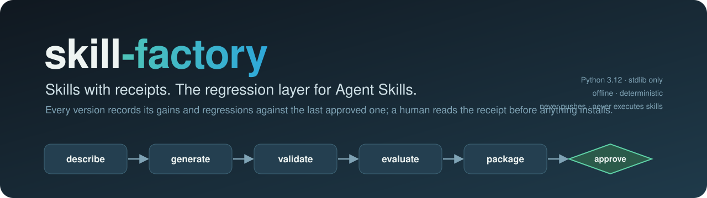
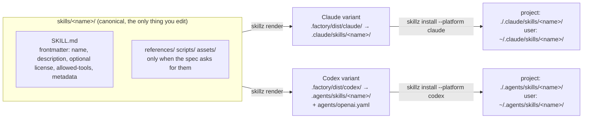
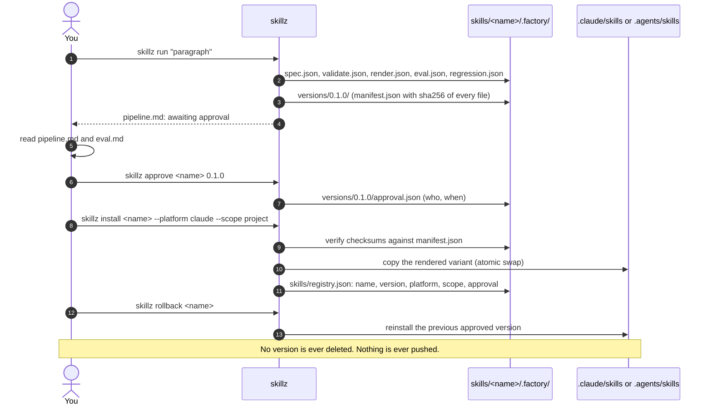
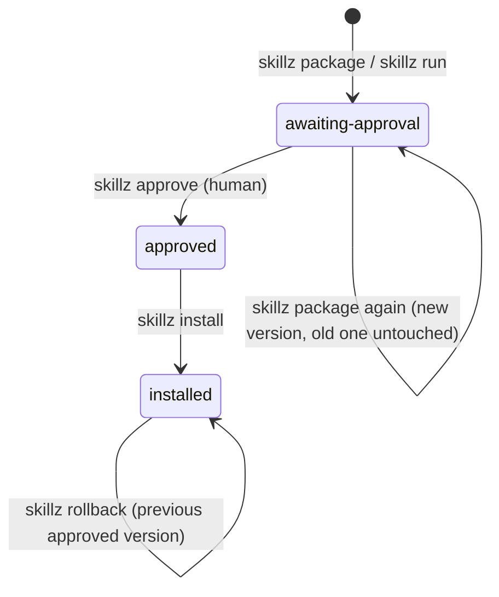
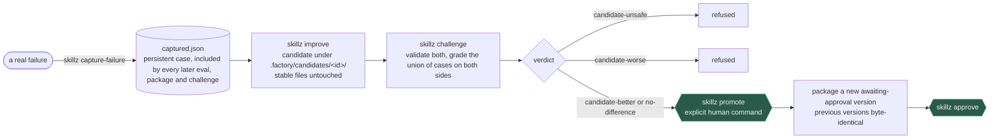
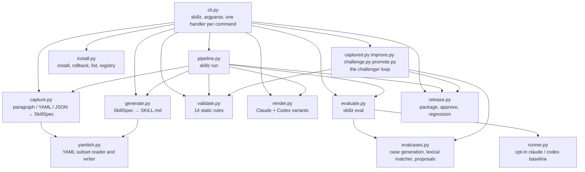

<p align="center">
  
</p>

<p align="center">
  <a href="https://github.com/Jimmycarroll2021/skill-factory/actions/workflows/ci.yml"></a>
  <a href="LICENSE"></a>
  
  
  
</p>

**skill-factory turns a paragraph into a tested, versioned Agent Skill for Claude Code and Codex.** You describe a capability in plain language. One command (`skillz run`) captures it as a spec, generates a canonical `SKILL.md`, validates it statically, renders thin Claude and Codex variants, generates and grades trigger tests, checks for regressions against the last approved version, and packages an immutable, checksummed version. Then it stops. Nothing is installed until you run `skillz approve`. Every version stays available for rollback, and when a skill gets a real prompt wrong, a challenger loop proves a fix before anything stable changes.

It is a factory, not a drafting prompt. The valuable parts are the evaluation engine, the regression suite, the version history and the registry of proven skills. Everything runs offline and deterministically with the Python standard library; model-backed baseline runs are opt-in.

## What you write, what you get

You write a paragraph:

```text
Draft release notes for a software project from its merged pull requests and commit history.
The notes group changes into features, fixes and breaking changes, written in plain language
for end users. Use it when the user asks for a changelog entry, a release announcement or a
version summary. Never invent changes that are not in the input.
```

```bash
uv run skillz run tests/fixtures/paragraph.txt
```

You get `skills/draft-release-notes-software/SKILL.md`, a JSON report for every stage under `.factory/`, a packaged version `0.1.0` waiting for your approval, and this summary, verbatim from a real run with no model runner on PATH:

```markdown
# Pipeline: draft-release-notes-software

Status: **awaiting approval**

## Stages

- capture: captured draft-release-notes-software (paragraph) (report: `.factory/spec.json`)
- generate: generated skills/draft-release-notes-software/ (report: `SKILL.md`)
- validate: pass (report: `.factory/validate.json`)
- render: rendered claude, codex (report: `.factory/render.json`)
- evaluate: 6 passed, 2 failed (heuristic); baseline: skipped: no runner (report: `.factory/eval.json`)
- regression: no-baseline (report: `.factory/regression.json`)
- package: created 0.1.0 (report: `.factory/versions/0.1.0/manifest.json`)
- approval: awaiting approval

## Next steps

1. `skillz approve draft-release-notes-software 0.1.0`
2. `skillz install draft-release-notes-software --platform claude|codex --scope project|user`
```

The two failed cases are the point: the evaluation found trigger prompts the description does not cover, and `.factory/eval.md` proposes the words to add. You can fix the description by hand, or let the [challenger loop](#self-improvement-the-challenger-loop) do it and prove the fix.

## The pipeline

```mermaid
flowchart LR
    you([You]) -->|paragraph or spec| A[describe]
    A --> B[capture<br/>spec.json]
    B --> C[generate<br/>SKILL.md]
    C --> D[validate<br/>static checks]
    D --> E[render<br/>Claude + Codex variants]
    E --> F[evaluate<br/>trigger + behaviour cases]
    F --> G[regression<br/>vs last approved]
    G --> H[package<br/>immutable version]
    H --> I{{human approval gate<br/>skillz approve}}
    I --> J[install<br/>.claude/skills or .agents/skills]
    J --> K[(registry<br/>skills/registry.json)]
    K -.->|skillz rollback| J
    style I fill:#2b5a4a,stroke:#5fd3a8,color:#eef4f2
```



The same stages as a plain list:

1. describe: you write a paragraph, or a small YAML or JSON spec
2. capture: `skillz` turns it into a structured spec (name, description, triggers, non-triggers, behaviours)
3. generate: the canonical `skills/<name>/` directory is written
4. validate: static checks on structure, size and forbidden patterns; nothing is executed
5. render: the Claude and Codex install variants are built from the canonical source
6. evaluate: positive and negative trigger cases and behaviour cases are generated and graded
7. regression: the candidate is compared with the last approved version's cases
8. package: an immutable, checksummed version is created under `.factory/versions/`
9. human approval gate: you run `skillz approve`; nothing is installable before this
10. install: the approved version is copied into the platform directory, and only there
11. registry: installs are recorded in `skills/registry.json`; `skillz rollback` reinstalls the previous approved version

`skillz run` performs stages 2 to 8 and stops at the gate. It never approves, never installs and never promotes. Each stage can also be run on its own (`skillz validate`, `skillz render`, `skillz eval`, `skillz package`).

## One source, two platforms

Claude Code and Codex both read the open Agent Skills format, so there is one canonical skill and two thin renderings of it. The canonical files are never edited per platform; `skillz render` proves they are byte-identical before and after rendering.



| Layer | Shared (canonical) | Claude variant | Codex variant |
|---|---|---|---|
| Instructions | `SKILL.md` with spec-compliant frontmatter | same file | same file |
| Supporting files | `scripts/`, `references/`, `assets/` | copied | copied |
| Platform metadata | none | none needed | `agents/openai.yaml` (name, description, interface) |
| Install path | `skills/<name>/` in your project | `.claude/skills/<name>/` or `~/.claude/skills/<name>/` | `.agents/skills/<name>/` or `~/.agents/skills/<name>/` |

## A release, step by step



## Version lifecycle



- A version directory is never modified after creation. `skillz approve`, `install` and `rollback` all re-verify the SHA-256 manifest first, so a tampered version cannot be approved or installed.
- `skillz package` re-runs the previous approved version's trigger cases against the new candidate. A case that passed before and fails now stops the package unless you pass `--allow-regression`.
- `skillz install` refuses anything that is not approved, with a non-zero exit and no files written.

## Self-improvement (the challenger loop)

When a skill gets a prompt wrong in real use, you do not edit the stable skill. You record the failure, build a challenger, and let the challenge decide.



```bash
# 1. record the failure; every later eval, package and challenge includes it
uv run skillz capture-failure <name> --prompt "Help me write a SKILL.md file" --should-trigger

# 2. build a candidate under skills/<name>/.factory/candidates/<id>/ (stable files untouched)
uv run skillz improve <name>

# 3. compare candidate with stable and read the verdict in challenge.md
uv run skillz challenge <name> c001

# 4. a human decides: promote, then approve the new version as usual
uv run skillz promote <name> c001
uv run skillz approve <name> <new-version>
```

- `capture-failure` appends to `.factory/cases/captured.json` with `--should-trigger`, `--should-not-trigger` or `--expect MARKER ...` (a behaviour case). Records are never rewritten.
- `improve` applies the evaluation's proposals and the captured failures deterministically: it extends the frontmatter `description` with the missing trigger words (never past 1024 characters), adds captured prompts to the spec's trigger lists and copies the body unchanged.
- `challenge` validates the stable skill and the candidate, grades the union of both sides' cases plus the captured ones, and gives one verdict, by precedence: `candidate-unsafe` (the candidate has a validation error), `candidate-worse` (a case that passed on stable fails on the candidate), `candidate-better` (a case improved, none regressed) or `no-difference`.
- `promote` refuses unless the challenge is current and the verdict is `candidate-better` or `no-difference`. It replaces the canonical files, packages a new `awaiting-approval` version and leaves earlier versions byte-identical. A refused or failed promote changes no canonical file, and the same candidate cannot be promoted twice.

Promotion is an explicit human command. `skillz run` and the pipeline never promote, approve or install. Grading is the same lexical-overlap heuristic as `skillz eval`: a better verdict is a signal about the description, not proof that a model will behave better.

**The factory improved itself this way.** The meta-skill in `skills/skill-factory/` missed the prompt "Help me write a SKILL.md file so my agent learns this workflow" (overlap score 0.14, below the 0.3 threshold). It was captured, a candidate was built, the challenge came back `candidate-better` with one improvement and no regressions, and the candidate was promoted. The committed report is [docs/evidence/skill-factory-challenge.md](docs/evidence/skill-factory-challenge.md).

## Quickstart

Requirements: Python 3.12 and [uv](https://docs.astral.sh/uv/). No API key, no network and no model CLI are needed for anything in the pipeline.

```bash
git clone https://github.com/Jimmycarroll2021/skill-factory
cd skill-factory
uv sync
```

```bash
# 1. capture, generate, validate, render, evaluate, regression check and package
uv run skillz run "Draft release notes from a list of merged pull requests, grouped by area."

# 2. read the per-stage summary the run wrote (the skill name is printed)
cat skills/<name>/.factory/pipeline.md

# 3. approve a version after reviewing it (a human decision)
uv run skillz approve <name> 0.1.0

# 4. install it for Claude Code or Codex
uv run skillz install <name> --platform claude --scope project

# 5. see what is installed, and go back if needed
uv run skillz list
uv run skillz rollback <name>
```

Pass `--out <dir>` to any command to work on a different project root; the default is the current directory. A spec file works as the source too: a `.yaml`, `.yml` or `.json` file with `name`, `description`, `triggers`, `non_triggers`, `behaviours` and an optional `resources` list of `scripts`, `references` and `assets`. See `tests/fixtures/spec.yaml`.

## Commands

| Command | What it does | Exit codes |
| --- | --- | --- |
| `skillz run <source> [--name NAME] [--runner {claude,codex}] [--force]` | The pipeline: capture, generate, validate, render, evaluate, regression, package; stops at awaiting approval and writes `.factory/pipeline.json` and `pipeline.md`. | 0 awaiting approval, 1 stopped by a failed stage, 2 input error |
| `skillz new <source> [--name NAME] [--force]` | Capture a skill from a paragraph or a `.txt`/`.yaml`/`.yml`/`.json` spec and generate `skills/<name>/`. | 0, 2 |
| `skillz validate <name>` | Check frontmatter, naming, paths, sizes, secrets, network calls and destructive shell. Writes `.factory/validate.json` and `validate.md`. | 0 clean, 1 errors, 2 missing |
| `skillz render <name>` | Build the Claude and Codex variants under `.factory/dist/` without touching canonical files. | 0, 2 |
| `skillz eval <name> [--runner {claude,codex}] [--strict]` | Generate cases, grade them offline, propose improvements; with `--runner` and that CLI on PATH, run each behaviour case with and without the skill. | 0 (advisory), 1 with `--strict` on a failing trigger case, 2 |
| `skillz package <name> [--minor \| --major] [--set-version X.Y.Z] [--allow-regression]` | Validate, render and evaluate, compare with the last approved version, and write an immutable version under `.factory/versions/<semver>/`. | 0, 1 validation or regression, 2 clash or missing |
| `skillz approve <name> <version>` | Verify checksums and record approval (UTC time and local user). The only way a version becomes installable. | 0, 1 integrity, 2 missing |
| `skillz install <name> --platform {claude,codex} --scope {project,user} [--version X.Y.Z]` | Install an approved version (default: highest approved) and record it in `skills/registry.json`. | 0, 1 not approved or integrity, 2 |
| `skillz rollback <name> [--platform {claude,codex}] [--scope {project,user}]` | Reinstall the highest approved version below the installed one. Versions are never deleted. | 0, 1 nothing to roll back to, 2 |
| `skillz list [--json]` | Show the registry and each skill's versions with their status. | 0 |
| `skillz capture-failure <name> --prompt TEXT (--should-trigger \| --should-not-trigger \| --expect MARKER ...) [--note TEXT]` | Record a real failure as a persistent eval case in `.factory/cases/captured.json`. | 0, 2 |
| `skillz improve <name>` | Build a challenger candidate under `.factory/candidates/<id>/` from eval proposals and captured failures; stable files are untouched. | 0, 1 nothing to improve, 2 |
| `skillz challenge <name> <candidate-id>` | Validate stable and candidate, grade the union of cases on both sides, write `challenge.json` and `challenge.md`. | 0 for every verdict, 2 |
| `skillz promote <name> <candidate-id>` | Explicit human command: replace the canonical files with a challenged candidate and package a new version that waits for approval. | 0, 1 refused or rolled back, 2 |

## What lands on disk

```text
skills/
├── registry.json                      installs: name, version, platform, scope, who approved, when
└── <name>/
    ├── SKILL.md                       the canonical skill (the only file you edit by hand)
    ├── scripts/ references/ assets/   only when the spec asks for them
    └── .factory/                      everything the factory produces (gitignore it or keep it as evidence)
        ├── spec.json                  structured spec captured from your paragraph
        ├── validate.json / .md        static checks
        ├── render.json / .md          variant manifest with sha256 per file
        ├── cases.json                 generated trigger and behaviour cases (stable ids)
        ├── eval.json / .md            offline grades, weak areas, proposals, baseline status
        ├── regression.json / .md      comparison with the last approved version
        ├── pipeline.json / .md        per-stage verdicts and the next commands to run
        ├── dist/claude/  dist/codex/  the rendered variants
        ├── cases/captured.json        failures you recorded with capture-failure
        ├── candidates/<id>/           challenger candidates with candidate.json and challenge.json / .md
        └── versions/
            ├── index.json
            └── 0.1.0/                 immutable: manifest.json (sha256), approval.json, skill/, dist/, reports/
```

## What the factory checks

- **Validation rules** (static, nothing is executed): frontmatter and kebab-case name matching the directory, description length, allowed paths (`SKILL.md`, `scripts/`, `references/`, `assets/`, `.factory/`), file and total size limits, and patterns for secrets, network calls and destructive shell in scripts. A green report is not a security guarantee: pattern matching has false negatives.
- **Trigger tests**: positive and negative prompts are generated from the spec and graded offline by a lexical-overlap scorer against the skill's name and description. This is a heuristic signal, not evidence that a model will trigger the skill.
- **Behaviour cases**: generated from the spec. With the opt-in `--runner claude|codex` and that executable on PATH, each case runs with and without the skill and the difference is graded. Otherwise the report records `skipped: no runner` and the pipeline still completes.
- **Regression**: the previous approved version's trigger cases are re-run against the candidate. A newly failing case stops the pipeline unless you package with `--allow-regression`.

## How it is built



- One canonical skill source in `skills/<name>/`; the Claude and Codex variants are thin renderings of it and are never edited by hand.
- Offline and deterministic by default. Model runners are opt-in and never needed to finish. The test suite patches `subprocess` so the real `claude` or `codex` can never be spawned by a test.
- Versions are immutable and checksummed; install, rollback and promote verify the checksums.
- A human approval gate sits between packaging and installing, and a human promote sits between a challenger and the stable skill. The tool never approves or promotes for you.
- No `git push` and no publishing, ever. Skills are never executed by the factory.
- Standard library only at runtime; `pytest` and `ruff` are the only development dependencies.

## Use the meta-skill

The repository ships its own skill, `skills/skill-factory/SKILL.md`, which tells an agent how to drive `skillz`: run the pipeline, read `pipeline.md`, report to you, and approve, install or promote only when you say so. Add it to an agent by copying or symlinking `skills/skill-factory` into `.claude/skills/` (Claude Code) or `.agents/skills/` (Codex).

The dogfooding path uses the factory on itself, from the repository root:

```bash
uv run skillz validate skill-factory
uv run skillz package skill-factory
uv run skillz approve skill-factory 0.1.0
uv run skillz install skill-factory --platform claude --scope project
```

## Development

```bash
uv sync --group dev
uv run pytest -q
uv run ruff check src tests
bash scripts/gate.sh
```

CI runs ruff and pytest on Ubuntu and Windows. See [CONTRIBUTING.md](CONTRIBUTING.md) and [CHANGELOG.md](CHANGELOG.md).

## How this repository was built

This repository was built unattended with [quickship](https://github.com/Jimmycarroll2021/quickship), an agent harness, in six reviewed missions: a strategist turned a one-paragraph idea into a PRD and mission briefs, and each mission ran through a planner, parallel workers in git worktrees, a read-only reviewer that graded the acceptance rubric on its own evidence, and a security reviewer. The harness and its evidence are committed: `scripts/`, `tests/*.sh`, `CLAUDE.md`, `BRIEF*.yaml`, `docs/missions/`, `docs/PRD.md`, `docs/PROGRAM.md` and the per-mission reports and ledgers under `docs/runs/`. They are not part of the `skillz` package and you can ignore them when using the tool. The package itself is `src/skill_factory/`.

## Licence

MIT. See [LICENSE](LICENSE).
